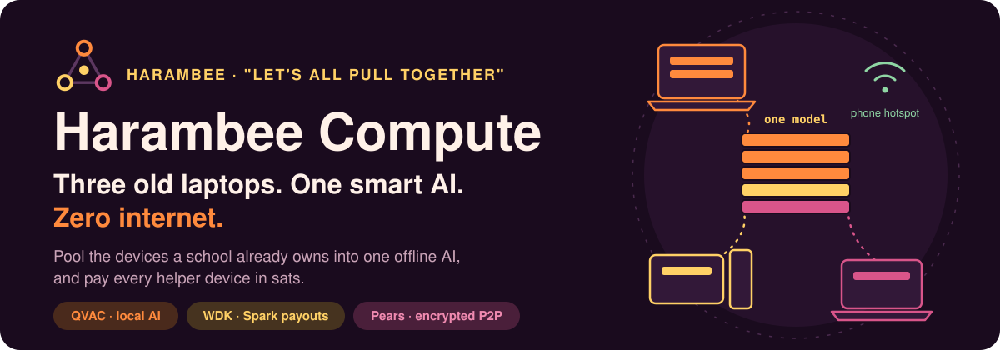
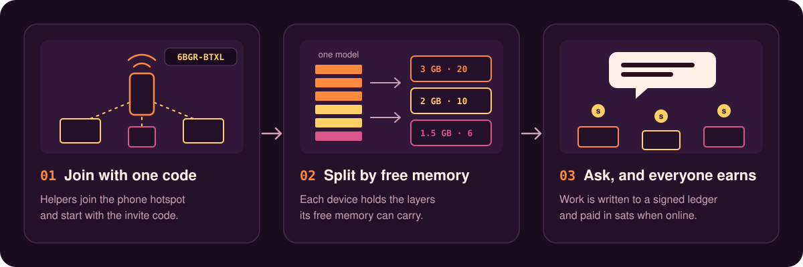
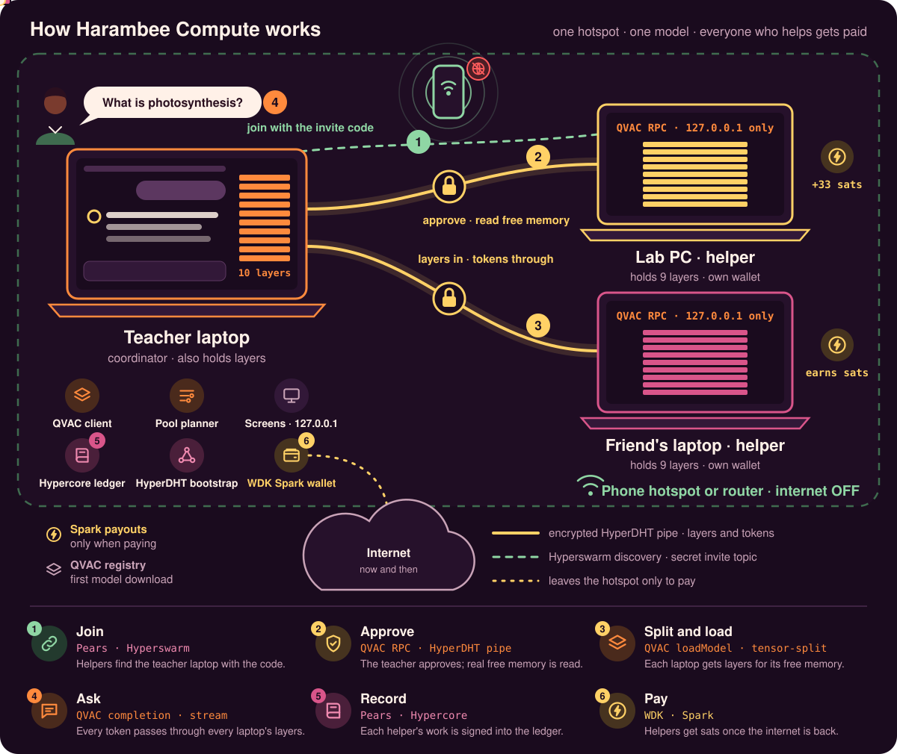

<p align="center">
  
</p>

<p align="center">
  
  
  
  
  
  
</p>

<p align="center">
  <b>Harambee</b> is Swahili for <i>"let's all pull together"</i>.<br>
  We pull the computers a school already owns into <b>one private AI</b> that runs on a <b>phone hotspot</b>,<br>
  and we <b>pay every device that helps</b> in sats.
</p>

<p align="center"><b>Demo video (internet off):</b> [DEMO VIDEO LINK]</p>

---

## The problem

A typical school computer lab has twenty PCs with 4 GB of memory, no graphics card, and a data bundle that runs out fast.

| | |
|---|---|
| **Cloud AI needs data** | Every question costs bundles. When the internet drops, the lesson stops. |
| **Student data leaves the school** | Questions, names and essays go to servers in another country. |
| **One PC means a tiny model** | A 4 GB machine can only run a small model, and small models get school questions wrong. |

**Who it is for:** schools, colleges, clinics and community centres in places like Nairobi that have several weak computers, poor internet, and data they want to keep private.

## The solution

Harambee Compute splits **one bigger model** across the devices in the room. Each device holds a few of the model's layers. A question passes through all of them, and the answer comes back. Nothing leaves the hotspot.

<p align="center">
  
</p>

1. **Join with one code.** The coordinator shows an invite code and QR. Helpers start the app with the code. The coordinator approves each one.
2. **Split by free memory.** The coordinator reads each helper's real free memory over the QVAC RPC protocol, then hands out layers. It uses the fewest devices that fit and tells you when one more device would unlock a smarter model.
3. **Ask, and everyone earns.** Answers stream to the screen. Each helper's work (tokens × layers) is written to a signed ledger. When there is internet, the coordinator pays each helper in sats with a WDK Spark wallet.

## Proof, measured

All numbers come from real runs on 25 to 27 October 2026.

| What we ran | Result |
|---|---|
| Qwen3 0.6B split 14 / 14 across two helpers, **through the encrypted pipes** | loaded in **30 to 32 s**, answered at **5.9 to 7.0 tokens/s** |
| Llama 3.2 1B split across two QVAC RPC servers on one laptop | **10.9 tokens/s** |
| A helper left while holding half the model | noticed in **13 s**, model reloaded on the device left, next question answered |
| The coordinator restarted | the helper rejoined in **about 60 s** and was approved again on its own |
| Encrypted pipe on its own | connected in **39 ms**, about **8 MB/s**, a stranger's connection was **refused** |
| Laptop + a far cloud server over the internet | **1.2 tokens/s**, which is why the pool stays on one hotspot |

## Architecture

<p align="center">
  
</p>

| Link | Carries | Needs internet? |
|---|---|---|
| ① WebSocket | the screens ↔ the coordinator, on `127.0.0.1` only, with an origin check | No |
| ② Hyperswarm | join requests on a secret topic made from the invite code | No, the coordinator runs its own HyperDHT bootstrap |
| ③ HyperDHT pipe | model layers and compute, end to end encrypted | No |
| ④ Spark | payouts to helpers | **Yes**, only when sending |

**Security in one line:** the QVAC RPC server on every helper listens on `127.0.0.1` only. The only way in is an encrypted HyperDHT pipe whose firewall accepts just the coordinator that approved it.

### What needs the internet

| Works offline | Needs the internet |
|---|---|
| Every AI answer | Downloading a model the first time (QVAC registry) |
| Finding devices and splitting the model | Sending payouts and reading the wallet balance (Spark) |
| Encrypted links between devices | Installing the app (`npm ci`) |
| The signed work ledger | |

## Tech stack

| Part | Tool | Version |
|---|---|---|
| Local AI and layer split | `@qvac/sdk`, `@qvac/ggml-rpc-server` | 0.22.0, 0.6.0 |
| Device links | `hyperswarm`, `hyperdht` | 4.17.2, 6.34.1 |
| Work ledger | `hypercore`, `corestore` | 11.39.3, 7.16.1 |
| Payouts | `@tetherto/wdk-wallet-spark` on REGTEST | 1.0.0-beta.30 |
| Screens | React, Vite, `ws` | 19.3.1, 8.3.5, 8.22.0 |
| Language | TypeScript, run directly by Node 24 | Node 24.13.1 |

## How we used the hackathon stack

### QVAC: the AI, split across devices
- Each helper starts a **QVAC RPC server** on `127.0.0.1` with `startRpcServer` → [`src/helper/startLocalRpcServer.ts`](src/helper/startLocalRpcServer.ts)
- The coordinator reads every helper's free memory with the RPC protocol itself (`HELLO`, `DEVICE_COUNT`, `GET_DEVICE_MEMORY`) → [`src/pool/readRpcInventory.ts`](src/pool/readRpcInventory.ts)
- The planner splits layers by that memory → [`src/pool/allocateLayers.ts`](src/pool/allocateLayers.ts), with advice in [`src/pool/getAdvice.ts`](src/pool/getAdvice.ts)
- `loadModel` gets every helper as `rpc-servers` with `split-mode: layer` and a `tensor-split` from the planner → [`src/inference/loadPoolModel.ts`](src/inference/loadPoolModel.ts)
- `completion` streams the answer → [`src/inference/streamAnswer.ts`](src/inference/streamAnswer.ts)
- The worker is built with the RPC provider from [`qvac.config.json`](qvac.config.json) using `npx qvac bundle sdk`
- Models come from the QVAC registry: [`src/inference/modelCatalog.ts`](src/inference/modelCatalog.ts)

### WDK: paying the helpers
- Every device makes a BIP-39 seed once and a Spark REGTEST account → [`src/wallet/openSparkWallet.ts`](src/wallet/openSparkWallet.ts)
- Helpers send their Spark address when they join → [`src/wallet/readWalletAddress.ts`](src/wallet/readWalletAddress.ts)
- The coordinator pays what the ledger says is owed with `sendTransaction`, and writes each payout back to the ledger so a retry never pays twice → [`src/coordinator/payHelpers.ts`](src/coordinator/payHelpers.ts)
- Rate: 1 sat for every 10 token-layers a helper computes → [`src/ledger/summarizeEarnings.ts`](src/ledger/summarizeEarnings.ts)

### Pears: finding devices and keeping a record
- The coordinator runs its own **HyperDHT bootstrap** so peers find each other with no internet → [`src/coordinator/startCoordinator.ts`](src/coordinator/startCoordinator.ts)
- Helpers join a **Hyperswarm** topic made from the invite code → [`src/helper/joinPool.ts`](src/helper/joinPool.ts)
- RPC travels through an **encrypted HyperDHT pipe** with a firewall → [`src/network/startRpcPipeServer.ts`](src/network/startRpcPipeServer.ts), [`src/network/startRpcPipeClient.ts`](src/network/startRpcPipeClient.ts)
- Every answer's work goes into an append-only, signed **Hypercore** → [`src/ledger/openLedger.ts`](src/ledger/openLedger.ts)

## A real day with Harambee

> **08:00** Mwalimu Wanjiru turns on her phone hotspot with mobile data **off** and starts the coordinator on her laptop.
> **08:05** Three lab PCs start the helper with the code on the board. She taps **Approve** three times.
> **08:07** The Model screen says Qwen3 4B needs the pool and suggests leaving out the slowest PC. She loads it.
> **08:10** Her Form 2 class asks about photosynthesis. Answers stream in, made by four machines together, and nothing leaves the room.
> **10:40** One PC is switched off. The pool notices, reloads on the other three, and the lesson goes on.
> **16:30** Back on Wi-Fi, she presses **Send payouts**. Each PC owner is paid in sats for the work their machine did, as written in the ledger.

The names are an example. The steps are what the app does today.

## Setup

**You need:** Node 24, Windows 10+, macOS 14+ or Ubuntu 22+, a Vulkan driver on Windows, and every device on the same Wi-Fi or phone hotspot.

On every laptop, once (needs internet):
```bash
git clone https://github.com/FlemingJohn/harambee-compute.git
cd harambee-compute
npm ci
npx qvac bundle sdk
```

On the coordinator laptop:
```bash
npm run build
npm run coordinator -- --host <this laptop's hotspot IP> --name Teacher-laptop --gpu
```
Open **http://127.0.0.1:8080**. The terminal prints the invite code, for example `HARAMBEE-6BGR-BTXL@192.168.43.10:49737`.

On each helper laptop:
```bash
npm run helper -- --code HARAMBEE-6BGR-BTXL@192.168.43.10:49737 --name Lab-PC-07
```
Then press **Approve** on the Devices screen, pick a model on the Model screen, and ask in Chat.

| Option | Where | What it does |
|---|---|---|
| `--host` | coordinator | the IP helpers use to reach the coordinator |
| `--gpu` | both | marks the device as having a graphics card |
| `--spread` | coordinator | uses every device even when fewer would fit |
| `--name` | both | the name shown on the screens |

When Windows asks, allow Node.js on **private networks**.

**Get test sats for payouts** (needs internet, once):
```bash
npm run fund
```
It prints the coordinator wallet's REGTEST deposit address. Paste it at the [Lightspark regtest faucet](https://app.lightspark.com/regtest-faucet) and press **Send Funds**. Then run `npm run fund` again: it finds the faucet deposit, claims it into the Spark wallet and prints the balance. A specific deposit can also be claimed with `npm run fund -- --claim <transaction hash>`.

**Run the tests:** `npm test` (48 tests, including the encrypted pipe and every payout edge case) and `npm run typecheck`.

## Hardware, memory and models

| | |
|---|---|
| **Tested on** | Windows 11 Home, AMD Ryzen 5 3500U, Radeon Vega 8 (Vulkan), 6 GB RAM, Node 24.13.1 |
| **Model used in the tests** | Qwen3 0.6B Q4 (`QWEN3_600M_INST_Q4`), 382 MB, 28 layers |
| **Memory per device** | split 14 / 14, each device holds half the layers. The planner keeps 1 GB free on every device for its own apps |
| **Bigger models in the catalog** | Qwen3 1.7B (1.06 GB), Qwen3 4B (2.5 GB), Qwen3 8B (5.0 GB) |
| **Model licences** | Qwen3: Apache 2.0. Llama 3.2 1B, used only in `spike/`: Llama 3.2 Community License |

## Built during the event

Everything in `src/`, `test/`, `docs/` and `spike/` was written between 25 and 29 October 2026 for this hackathon.

Pre-existing, third-party work we build on: QVAC SDK and RPC server (Apache 2.0), WDK Spark wallet (Apache 2.0), Hyperswarm, HyperDHT, Hypercore and Corestore (MIT), React, Vite, `ws` and `qrcode` (MIT), `bip39` (ISC), and the Bricolage Grotesque, Instrument Sans and JetBrains Mono fonts (OFL 1.1), bundled so the screens work offline.

## Known limits

- A split is **slower** than one device. It wins on model size, not speed, so the planner uses the fewest devices that fit.
- Helpers need the app installed. Students chatting from a phone browser is next on the list.
- Payouts need REGTEST test sats in the coordinator wallet. Without them the payout is refused and stays queued, as tested.
- A helper's answers cannot be verified, so only approve devices you trust.
- Use the coordinator wallet only for Harambee payouts. A payout that lost its reply is matched against the wallet's own transfer history, so payments made from the same wallet in another app could confuse that check.
- Each laptop's wallet seed lives in `.harambee/…/seed.txt`. Back it up before using real money; deleting the folder loses the wallet.

## License

[MIT](LICENSE) © 2026 FlemingJohn
